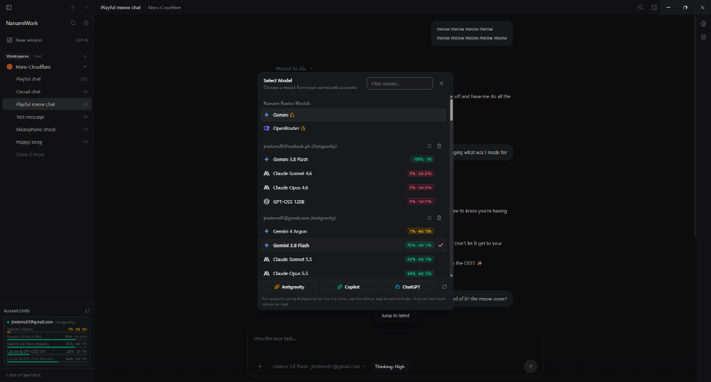

<p align="center">
  <h1 align="center">🌸 NanamiWork</h1>
  <p align="center">
    <strong>An agent instance manager, local router, and unified desktop frontend bringing your Antigravity, Codex, and GitHub Copilot accounts together.</strong>
  </p>
</p>

<p align="center">
  
</p>

## 🌟 Overview

**NanamiWork** is a desktop agent workspace and instance manager designed to effortlessly unify your developer accounts across **Google Antigravity**, **Codex (ChatGPT)**, and **GitHub Copilot**.

Instead of juggling scattered CLI tokens, separate login flows, or conflicting global configurations, NanamiWork provides a clean, single-pane desktop frontend. Connect your free, promo, student, personal, or paid subscription accounts, route turns automatically across them with **NanamiWork Local Router**, monitor live quotas and rolling limits in real time, and run agent tasks in an isolated, conflict-free profile.

## ✨ Features

* **🛡️ 3-in-1 Agent Instance Manager**  
  Link, manage, and switch between your instances across **Google Antigravity**, **Codex (ChatGPT)**, and **GitHub Copilot** with 1-click device and browser authorization.

* **🔀 NanamiWork Local Router**  
  Automatically route turns across your connected accounts and models using configurable strategies (Model order, Account order, Round robin, Highest/Lowest quota, Earliest/Latest reset) with automatic quota-exhaustion failover (`<= 5%` remaining).

* **🧭 Orchestrator Mode**  
  Two-phase Planning and Execution workflow for supported Antigravity and ChatGPT plans: a dedicated planning model investigates read-only, produces a concrete plan, and hands off seamlessly to an execution model.

* **📊 Live Quotas, Rolling Limits & Stale Auth Recovery**  
  Track independent account health and quota exhaustion across free, promo, student, and paid tiers at a glance:
  * **Antigravity**: Adapts to each account's active tier with account-aware discovery for Gemini 4 (Neon, Hydrogen, Carbon, Argon), Gemini 3.8 Flash, Claude, and GPT-OSS models, displaying 7-day weekly limits with 5-hour exhaustion awareness.
  * **Codex (ChatGPT)**: Works across free, promo, student, and paid plans with adaptive rolling limit trackers (Free allowances vs Paid 5-hour and weekly limits), reasoning effort controls (Low / Medium / High), manual OAuth refresh, and clickable **Stale** pills to re-authenticate expired sessions in-place.
  * **GitHub Copilot**: 1-click GitHub device flow across free, Student Pack, and paid plans with automatic model discovery and monthly quota tracking.

* **⚙️ Reactive Background Tasks & Queue / Steer**  
  Long-running commands run in the background so Nanami goes idle while waiting and wakes up automatically with the exit code and output tail on completion. Follow-up queueing and immediate steering stay cleanly separated.

* **⚡ Complete Sandbox Isolation**  
  NanamiWork operates strictly inside its isolated profile (`~/.config/nanamiwork`). It never modifies or pollutes your global OpenCode, OpenWork, VS Code Copilot, Antigravity, or Codex installations.

* **⏪ "Undo Up to This Point" & Fluid Motion**  
  Rewind any turn on the fly with instant composer restoration, paired with 60fps streaming and GPU-light spring animations with full `prefers-reduced-motion` support.

* **💻 Cross-Platform & Portable**  
  Zero hardcoded paths or assumptions. Works out of the box across Windows, Linux, and macOS.

## 📥 Downloads

Grab the latest installer for your operating system from the [**Releases Page**](https://github.com/JmDemisana/NanamiWork/releases):

| Platform | Format | Notes |
| :--- | :--- | :--- |
| **Windows** | `.exe` / `.appx` | Windows 10 / 11 NSIS setup and AppX package |
| **Linux (Debian / Ubuntu)** | `.deb` | `x86_64` Debian package installer |
| **Linux (Universal)** | `.AppImage` | Portable `x86_64` binary for modern distributions |
| **macOS** | `.dmg` / `.zip` | Apple Silicon (`arm64`) builds |

## 🚀 Quick Start

1. **Launch NanamiWork**.
2. **Connect Your Platforms**:
   * Open the Model Picker (`Select Model`).
   * Connect **Antigravity**, **Copilot**, or **ChatGPT** via 1-click device or browser authorization.
3. **Choose an Account, Local Router, or Orchestrator**:
   * Pick any model from your connected accounts, or enable **NanamiWork Local Router** / **Orchestrator**.
   * Open your local workspace folder and start building!

## 🛠️ Building from Source

```bash
# Clone the repository
git clone https://github.com/JmDemisana/NanamiWork.git
cd NanamiWork

# Install workspace dependencies
pnpm install

# Build the Electron bundle
pnpm --filter @openwork/desktop build:electron

# Package for your platform
pnpm --dir apps/desktop exec electron-builder --config electron-builder.yml
```

## ⚖️ Provider Terms & Compliance

NanamiWork provides multi-account profile switching to help developers organize personal, educational, and workplace credentials across distinct workspace contexts. All API interactions and authentication flows occur directly between the user's client and the upstream services (Google, OpenAI, GitHub). Users are solely responsible for complying with the Terms of Service, Acceptable Use Policies, and rate limits of each respective provider. NanamiWork does not alter, bypass, or circumvent provider access controls.

## 📄 License & Attribution

NanamiWork is licensed under the [GNU General Public License v3.0 (GPL-3.0)](./LICENSE).  
NanamiWork is grateful to the projects and people whose work makes it possible:

- [OpenWork](https://github.com/different-ai/openwork) by Different AI, Inc. provides the foundation NanamiWork is built on.
- [OpenCode](https://github.com/anomalyco/opencode) provides the agent engine and the upstream code used by the vendored code-mode package. See its [upstream notes](./packages/codemode/UPSTREAM.md) and [notice](./packages/codemode/NOTICE).
- [opencode-antigravity-auth](https://github.com/NoeFabris/opencode-antigravity-auth) by NoeFabris and contributors provides the community Antigravity authentication plugin used by NanamiWork.
- [Electron](https://www.electronjs.org/) and [React](https://react.dev/) provide the desktop application and interface frameworks.

NanamiWork also connects to services from [Google Antigravity](https://antigravity.google/), [OpenAI](https://openai.com/), and [GitHub Copilot](https://github.com/features/copilot). These are independent products, and their inclusion does not imply endorsement or affiliation.

These projects and their dependencies retain their own licenses and notices. See the [Documents third-party notices](./packages/documents/THIRD_PARTY_NOTICES.md) for that package's dependencies.
