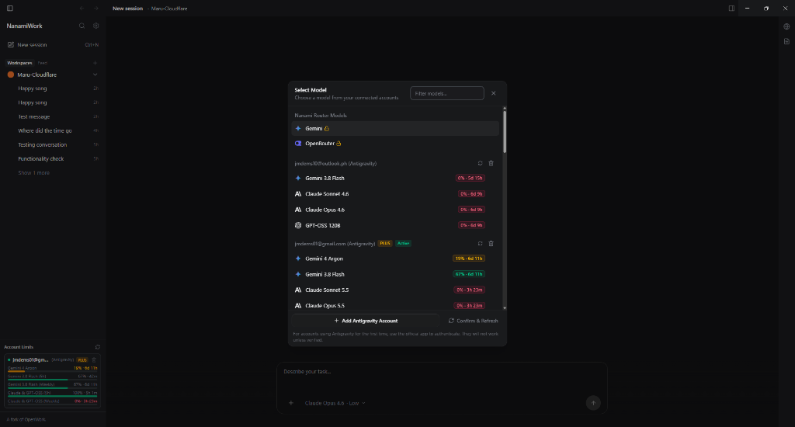

<p align="center">
  <h1 align="center">🌸 NanamiWork</h1>
  <p align="center">
    <strong>A high-performance desktop agent workspace for AI pair-programming and system automation.</strong>
  </p>
  <p align="center">
    <a href="https://github.com/JmDemisana/NanamiWork/releases"></a>
    <a href="https://github.com/JmDemisana/NanamiWork/blob/main/LICENSE"></a>
    <a href="https://nanami-ai.pages.dev"></a>
  </p>
</p>

<p align="center">
  
</p>

---

## 🌟 Overview

**NanamiWork** is a distraction-free desktop environment for AI pair-programming, terminal automation, and workflow orchestration. Designed with speed, precision, and elegance in mind, NanamiWork brings effortless multi-account management, real-time quota monitoring, and curated AI routing straight to your desktop.

---

## ✨ Features

* **🛡️ Seamless Multi-Account Management**  
  Connect multiple developer accounts with one click via official browser authentication. Switch between profiles effortlessly and monitor remaining usage quotas in real time.

* **🔒 Nanami Gateway Integration**  
  Direct, secure access to curated high-performance AI models, smart auto-routing, and dedicated coding assistants.

* **⏪ "Undo Up to This Point"**  
  Made a detour or want to rephrase? Rewind your conversation timeline with one click. NanamiWork restores your prompt back into the composer and readies your cursor so you can iterate instantly.

* **⚡ Completely Conflict-Free & Portable**  
  Runs with fully sandboxed configurations and bundled sidecars. It will never interfere with existing global terminal tools or local configurations on your machine.

---

## 📥 Downloads

Grab the latest installer for your operating system from the [**Releases Page**](https://github.com/JmDemisana/NanamiWork/releases):

| Platform | Format | Notes |
| :--- | :--- | :--- |
| **Windows** | `.exe` | Windows 10 / 11 NSIS setup |
| **Linux (Debian / Ubuntu)** | `.deb` | Standard package installer |
| **Linux (Universal)** | `.AppImage` | Portable binary for all modern distributions |
| **macOS** | `.dmg` / `.zip` | Universal support for Apple Silicon and Intel |

---

## 🚀 Quick Start

1. **Launch NanamiWork** on your computer.
2. **Add Your Account**:
   * Open the model selector and click **+ Add Antigravity Account**.
   * Sign in via your browser to link your account and view live quotas.
3. **Select a Model & Start Working**:
   * Choose any model from your active account or the Nanami suite.
   * Open a project folder and start pair-programming!

---

## 🛠️ Building from Source

```bash
# Clone the repository
git clone https://github.com/JmDemisana/NanamiWork.git
cd NanamiWork

# Install workspace dependencies
pnpm install

# Build the Electron bundle
pnpm --filter @openwork/desktop build:electron

# Package for your platform
pnpm --dir apps/desktop exec electron-builder --config electron-builder.yml
```

---

## 📄 License & Attribution

NanamiWork is licensed under the [MIT License](./LICENSE).  
Built upon the foundations of [OpenWork](https://github.com/different-ai/openwork) and [OpenCode](https://opencode.ai).  
Nanami integrations and design enhancements maintained by the [Nanami Project](https://nanami-ai.pages.dev).
